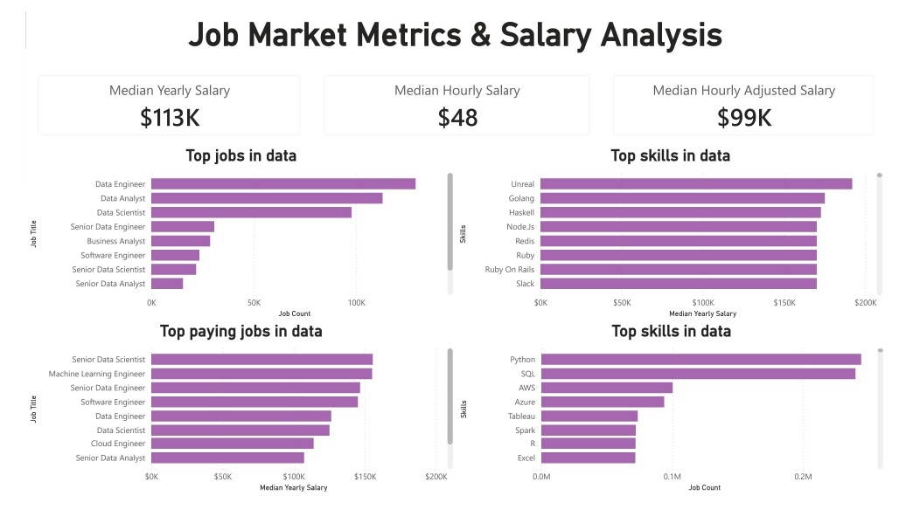

# Part 3: DAX

[← Back to main README](../README.md)

Covers the DAX chapter of Luke Barousse's Power BI course: calculated tables, explicit measures, evaluation context, and parameters. I rebuilt each lesson myself, one `.pbix` file per section (3 reports, 7 pages). Dataset: `job_postings_flat` (about 479,000 data job postings), modeled as fact and dimension tables.

## Files
- 📁 `Images/`: screenshots of every page
- 📊 Three Power BI reports (open with Power BI Desktop):

| File | Pages | What it covers |
|------|-------|----------------|
| `DAX Intro.pbix` | Calculated Table, Measures | `date_dim` calculated table (date key, year, quarter, month, week, weekday); Job Count, Median Yearly Salary, Median Hourly Salary, Median Hourly Adjusted Salary measures |
| `DAX Explicit Measures.pbix` | Skills vs Salary, Explicit Measures Problem | Skill Count, Skills per Job, Grand Total Skill Count (CALCULATE + ALL), a country-filtered median salary; practice problem with min/median/max salary, salary target status, % work from home, % degree mention |
| `DAX Parameters.pbix` | Parameters, Parameters 2, Parameters Problem | Field parameters (category and measure switchers), numeric range parameter for deduction rate and take-home pay, salary target parameter with a constant line |

## Page Gallery

| | |
|---|---|
|  **Calculated Table** Daily job posting trend and postings by weekday, using the DAX-built date table |  **Measures** Cards and bar charts for job demand, top skills and salaries, all driven by explicit measures |
|  **Skills vs Salary** Skill Count, Skills per Job and a scatter plot of skills vs median salary by job title |  **Explicit Measures Problem** Practice problem: salary min/median/max, target status and percentages by job title |
|  **Field Parameters** Field parameters that switch the chart category and measure |  **Numeric Range Parameters** Deduction-rate slider showing median yearly take-home pay next to median yearly salary |
|  **Parameters Problem** Practice problem: salary target slider, a salary statistic selector and a target line | |

## What I learned
- **Calculated columns vs tables vs measures:** columns and tables are computed at data load; measures are computed when a visual is built.
- **Power Query vs DAX:** do cleaning and new columns in Power Query; use DAX for measures. Calculated columns make files bigger.
- **Date table:** built with `CALENDARAUTO` and `ADDCOLUMNS`, marked as a date table, and used "sort by column" so weekdays appear in order.
- **Explicit vs implicit measures:** write a measure once (Job Count, Median Yearly Salary), set its format once, and reuse it in every visual.
- **Measure best practices:** a dedicated `_Measures` table, comments on each measure, and `DIVIDE` instead of `/` to handle divide-by-zero.
- **Context:** row context < query context < filter context. `CALCULATE` plus `ALL` changes the filter context, for example to get a grand total that ignores the visual's filters.
- **Parameters:** field parameters let users switch columns or measures in one chart; numeric range parameters feed a measure (deduction rate and salary target).

## What I followed vs changed
- Followed the course builds for all three sections.
- Used India instead of the United States for the country-filtered median salary measure.
- Practice problems (Explicit Measures Problem, Parameters Problem): the course provides the target dashboard, and I built the measures and parameters to reproduce it.
- Applied a purple theme to the visuals.

## Next
➡️ Course final project (Project #2: dashboard build and sharing)

